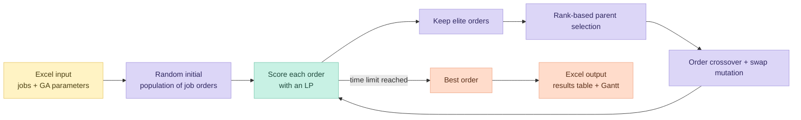

 

**A genetic algorithm searches the job order. A linear program places the idle time.**
Finish too early or too late, and every minute has a price.

> [!NOTE]
> **Production-optimization algorithms course, Ben-Gurion University · 2026**
> Implemented in Python, with AI-assisted development (Cursor, Gemini).

## 🧩 The problem

A single machine must process *n* jobs one after another. For each job *j*:

| Symbol | Meaning |
|---|---|
| tj | processing time |
| dj | due date |
| vj | cost per time unit of finishing **early** |
| wj | cost per time unit of finishing **late** |

The machine may be left idle between jobs. The goal is to minimize the total cost: the sum over all jobs of vj·Ej + wj·Tj, where Ej is earliness and Tj is tardiness.

This is a classic just-in-time scheduling problem. Choosing the job order is combinatorial (*n*! orders), but for a **fixed order** the best idle-time placement is a small linear program. The solution splits the work accordingly.

## 🧬 Approach

- **Encoding:** a solution is a permutation of the jobs.
- **Fitness (LP subproblem):** for a given order, a linear program (PuLP) decides completion times and idle gaps so that the total penalty is minimal.
- **Selection:** rank-based probabilities, so the best order is most likely to be chosen as a parent without dominating the population.
- **Crossover:** order crossover (OX): keeps a segment from one parent and fills the rest in the other parent's order, so no job is duplicated or lost.
- **Mutation:** random swaps, scaled with the number of jobs to avoid premature convergence.
- **Elitism:** the best solutions pass unchanged to the next generation.
- **Stopping rule:** a time limit given in the input file.
- **Baseline:** the original job order is solved first, so the report shows how much the GA improved on it.
- **Input validation:** population size must be an even integer between 20 and 200, and the number of elite solutions is limited to 10% of the population.

## 📊 Example

The 7-job instance used in the course (t = 4, 12, 4, 9, 6, 5, 12 · d = 30, 25, 32, 35, 45, 50, 65) is included as `example_7jobs.xlsx`.

| Schedule | Total penalty |
|---|---|
| Original order 1-2-3-4-5-6-7 (LP only) | **43** |
| Best possible order 2-3-1-4-5-6-7, found by checking all 5,040 orders | **17** |

## 📁 Project structure

| File | Role |
|---|---|
| `Project_Form.py` | Tkinter GUI: choose input/output file, switch between LP-only and genetic algorithm |
| `Tapi_Project_GA_Engine.py` | The genetic algorithm (population, selection, crossover, mutation, elitism, run loop) |
| `Tapi_Project_Solver_Engine.py` | The LP subproblem (PuLP), Excel reading, and results/Gantt writing |
| `example_7jobs.xlsx` | Example input |

## ▶️ How to run

1. Install Python 3.10+ and the dependencies: `pip install -r requirements.txt`
2. Start the GUI: `python Project_Form.py`
3. Enter the input file name without `.xlsx` (for example `example_7jobs`) and an output file name.
4. Tick **Run Genetic Algorithm?** to run the GA, or leave it unticked to evaluate the original order only.
5. Open the output `.xlsx` for the results table and the Gantt chart.

**Input layout:** row 1 holds job numbers, then rows 2-5 hold t, d, v, w (one column per job, starting at column B). Cells A7, A9, A11, A13 hold population size, number of elite solutions, mutation probability, and time limit in seconds.
